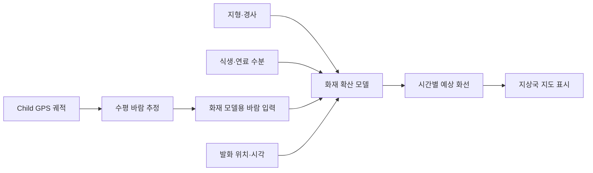

# 바람장 기반 화재 확산 예측 구상

CanSat의 Child 하강 궤적에서 추정한 수평 바람을 화재 확산 모델에 입력하고, 발화 위치를 기준으로 시간별 예상 화선을 지상국 지도에 표시한다.

## 모델과 구현 방향

- Rothermel 지표화 확산 모델을 후보로 검토한다. 바람, 경사, 연료 특성과 수분을 사용해 확산 속도를 계산하고 방향별 확산 모델과 결합한다.
- 지도 영역을 미터 단위 격자로 나누고 발화점에서 각 위치에 불이 도달하는 시간을 계산한다. 시간별 예상 경계와 바람 화살표를 지상국 지도에 표시한다.
- 첫 버전은 단일 발화점과 연료 조건, 선택한 고도의 대표 바람, 평지 또는 알려진 경사를 가정한다. 이후 지형·식생 지도와 공간별 바람을 추가한다.
- 기존 `MossSimulation`의 격자 지도와 시나리오 비교 방식은 참고한다. 기존 위험도 점수와 확산 모델의 결과는 구분한다.

## 입력과 해석의 한계

- Child의 이동 속도는 관측 경로 주변 수평 바람의 대리지표다. 관측 시각·위치·고도와 보간 및 외삽 가정을 함께 기록한다.
- Rothermel 모델에 필요한 화염 높이 풍속과 Child 관측 고도는 다르므로 높이 보정의 가정과 불확실성을 명시한다.
- 공기 상대습도는 연료 수분과 다르므로 연료 수분을 별도로 입력하거나 근거 있는 방법으로 추정한다.
- 서로 다른 시각의 Child 낙하 기록은 동시 관측 바람장으로 합치지 않고 기록별 시나리오로 비교한다.
- 실제 확산 예측의 신뢰도는 연료·지형·바람 자료와 현장 검증에 달려 있다.

## 참고 자료

- [미국 산림청: Rothermel 지표화 모델 설명](https://research.fs.usda.gov/treesearch/55928)
- [미국 산림청: FARSITE 모델 개발과 평가](https://research.fs.usda.gov/treesearch/4617)
- [미국 산림청: 화염 높이 풍속 보정](https://research.fs.usda.gov/treesearch/39729)
